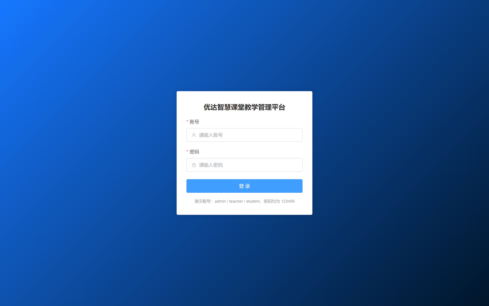
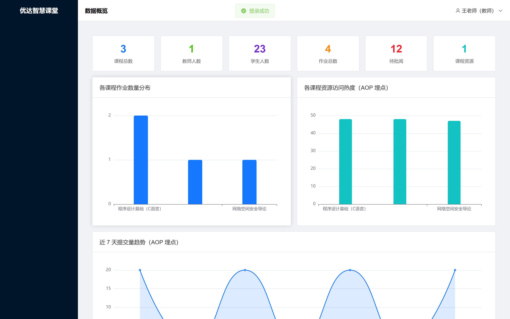
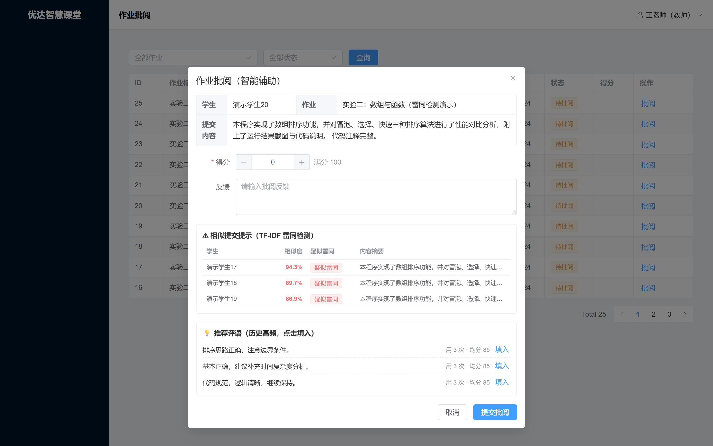
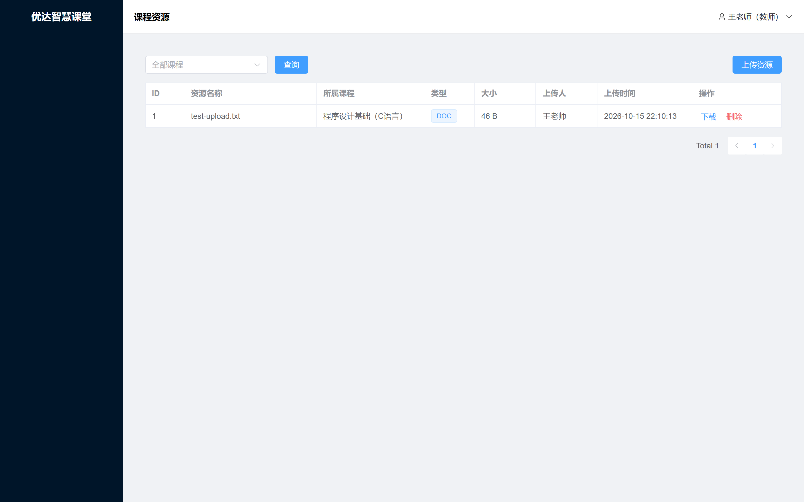
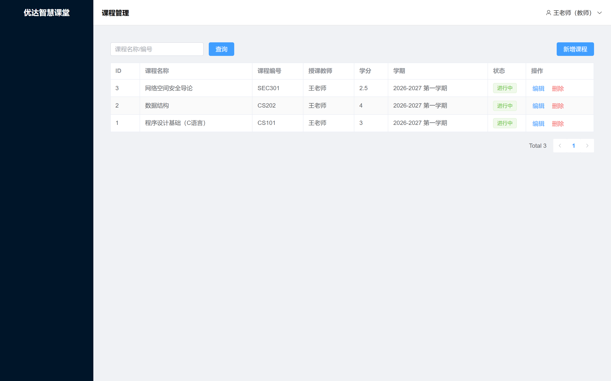
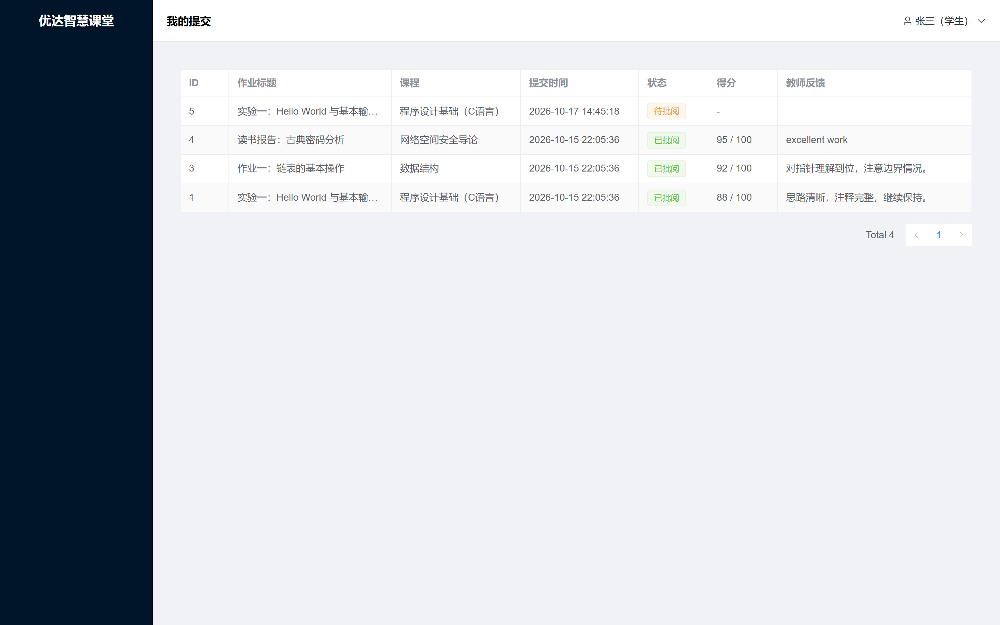

# 优达智慧课堂教学管理平台

[](https://github.com/CloudGiaohaooo/smart-classroom/actions/workflows/ci.yml)

> 一个前后端分离的在线教学管理平台，覆盖课程管理、作业发布与提交、作业批阅反馈、课程资源上传四大核心模块。
> 本项目作为软件开发实习的答辩项目，也适合作为考研复试 / 求职的作品展示。

## 一、项目简介

本系统面向高校教师与学生，提供：

| 模块 | 功能 | 对应实习工作 |
| --- | --- | --- |
| 课程管理 | 课程的新增、编辑、删除、分页查询、关键词搜索 | 前端「课程管理」页面开发 |
| 作业列表 | 作业的布置、编辑、删除、分页查询、课程筛选 | 前端「作业列表」页面开发 |
| 作业批阅反馈 | 学生提交作业、教师打分并填写反馈 | 后端「作业批阅反馈」接口开发 |
| 课程资源上传 | 资源文件上传、下载、分页查询、删除 | 后端「课程资源上传」接口开发 |

## 二、技术栈

| 层级 | 技术 |
| --- | --- |
| 前端 | Vue 3、Vite、Element Plus、Vue Router、Pinia、Axios、ECharts |
| 后端 | Spring Boot 3.2、MyBatis-Plus、MySQL 8、Redis、Spring AOP |
| 安全 | JWT 令牌认证、BCrypt 密码加密、Spring Security 过滤链 + RBAC 权限模型 |
| 质量 | RESTful API 设计、统一响应/异常处理、事务管理、SpringDoc 接口文档、JUnit 单测、Docker 部署 |

## 三、系统架构

```
浏览器（Vue3 SPA）
      │  HTTP / JSON（RESTful）
      ▼
Spring Boot 后端
  ├─ Controller 层：接收请求、参数校验、返回统一 Result
  ├─ Service 层：业务逻辑、@Transactional 事务控制
  ├─ Mapper 层：MyBatis-Plus BaseMapper + 自定义 SQL（多表 JOIN）
  └─ MySQL 数据库
        ├─ 业务表：course / assignment / submission / course_resource
        ├─ 权限表：sys_user / sys_role / sys_permission / sys_user_role / sys_role_permission
        └─ 埋点表：student_behavior（学习预警）
```

安全链路：登录 → 后端校验账号密码（BCrypt 比对）→ 签发 JWT → 前端每次请求携带 `Authorization: Bearer <token>` → 后端 Spring Security 过滤链解析 JWT 并注入用户上下文 → `@PreAuthorize` 方法级授权（RBAC 四表）。

## 四、目录结构

```
优达智慧课堂教学管理平台
├─ backend/                     # 后端（Spring Boot）
│  ├─ pom.xml
│  └─ src/main/
│     ├─ java/com/youda/classroom/
│     │  ├─ controller/         # 接口层
│     │  ├─ service/            # 业务层
│     │  ├─ mapper/             # 数据访问层（含多表 JOIN SQL）
│     │  ├─ entity/ dto/ vo/    # 实体 / 入参 / 出参
│     │  ├─ security/           # Spring Security 过滤链 + JWT 工具、用户上下文
│     │  ├─ config/             # 配置类、演示数据初始化
│     │  └─ common/             # 统一响应、异常、状态码
│     └─ resources/
│        ├─ application.yml
│        └─ db/schema.sql       # 建表脚本
├─ frontend/                    # 前端（Vue3 + Vite）
│  └─ src/
│     ├─ views/                 # 页面
│     ├─ layout/                # 布局
│     ├─ router/ store/ utils/ api/   # 路由、状态、请求封装、接口
│     └─ main.js App.vue
├─ docs/                        # 设计文档（数据库 / 接口 / 架构）
└─ 答辩材料/                     # PPT 大纲、问答、演示讲解稿
```

## 五、快速启动

### 1. 环境准备

- JDK 17+
- Maven 3.6+
- MySQL 8.x（默认账号 `root` / `root`，如不同请修改 `backend/src/main/resources/application.yml`）
- Node.js 18+（前端）

### 2. 启动后端

```bash
cd backend
mvn spring-boot:run
```

首次启动会自动完成三件事：
1. 自动创建数据库 `youda_classroom`（JDBC URL 中的 `createDatabaseIfNotExist=true`）；
2. 自动执行 `db/schema.sql` 建表（`IF NOT EXISTS`，幂等）；
3. 自动写入演示数据（`DataInitializer`）。

启动成功后，后端监听 `http://localhost:8080`。

### 3. 启动前端

```bash
cd frontend
npm install
npm run dev
```

访问 `http://localhost:5173`，使用以下演示账号登录（密码均为 `123456`）：

| 账号 | 角色 | 权限 |
| --- | --- | --- |
| admin | 管理员 | 全部功能 |
| teacher | 教师 | 课程管理、布置作业、批阅、上传资源 |
| student | 学生 | 查看课程/作业/资源、提交作业、查看我的提交 |

### 4. 常见问题

- **端口占用**：修改 `application.yml` 的 `server.port`，同步修改 `vite.config.js` 的代理 target。
- **数据库连接失败**：确认 MySQL 已启动、账号密码正确。
- **Maven 下载慢**：可配置阿里云镜像仓库。

## 六、核心亮点（答辩 / 复试可重点讲解）

### 差异化创新点（复试级）

1. **智能辅助批阅（创新点 A）**：纯 Java TF-IDF + 余弦相似度做「雷同提交检测」，历史评语频率统计做「一键推荐」，无需大模型、完全离线、阈值外置可调。
2. **学习预警看板（创新点 B）**：`student_behavior` 表 + `@BehaviorLog` 注解 + AOP 切面**零侵入埋点**，ECharts 展示提交率趋势 / 资源热力 / 预警学生，规则外置到 `application.yml`。
3. **课程资源 MD5 秒传去重（创新点 C）**：上传时纯 JDK `MessageDigest` 计算文件 MD5，相同文件复用既有物理文件、仅新增元数据（秒传），删除按 `file_url` 引用计数防误删；开关 `resource.dedup-enabled` 外置可调。

### 工程深度（生产级）

4. **RBAC + Spring Security**：四表权限模型 + JWT 无状态认证 + `@PreAuthorize` 方法级授权，替换原拦截器方案。
5. **Redis 缓存三策略**：空值缓存（防穿透）/ 互斥锁重建（防击穿）/ 随机 TTL（防雪崩），Redis 宕机自动降级直查 DB。
6. **可观测与质量**：`@RestControllerAdvice` 统一异常、SpringDoc 接口文档、JUnit 单测 + MockMvc 接口集成测试 + JaCoCo 覆盖率、GitHub Actions CI、Docker Compose 一键部署。

### 基础工程

7. **前后端分离 + RESTful**：资源化 URL、HTTP 方法语义、统一 `Result` 响应体。
8. **多表查询**：课程联表查教师名、作业联表统计提交数、提交记录四表 JOIN，演示 `LEFT JOIN` 与聚合子查询。
9. **事务管理**：作业批阅使用 `@Transactional`，保证得分/反馈/状态/时间原子更新。
10. **文件上传**：本地落盘 + 数据库元数据、按课程分目录、唯一文件名避免覆盖、MD5 秒传去重（见创新点 C）。

## 七、系统截图（界面预览）

| 界面 | 截图 |
| --- | --- |
| 登录页 |  |
| 学习预警看板（创新点 B） |  |
| 智能辅助批阅（创新点 A） |  |
| 课程资源（创新点 C） |  |
| 课程管理 |  |
| 学生提交（我的提交） |  |

## 八、后续可扩展方向

- 引入 MinIO 对象存储（内容寻址），替代本地磁盘存储，进一步支撑跨实例去重
- 消息队列（RocketMQ / RabbitMQ）实现批阅结果异步通知
- WebSocket 推送预警消息，把「教师主动看」升级为「实时告警」
- 课程资源全文检索（Elasticsearch）
- Element Plus 按需引入（unplugin-vue-components）进一步压缩 vendor 体积

## 九、改进路线图（复试级）

> 完整任务清单、验收标准与进度记录见 [`docs/improvement-plan.md`](docs/improvement-plan.md)。以下为概要。

围绕「智能」与「可信」两个关键词做增量，在不推倒重来的前提下补齐差异性与工程深度：

| 阶段 | 内容 | 状态 |
| --- | --- | --- |
| Phase 1 | 基线与文档（`dev` 分支、改进计划、路线图） | ✅ |
| Phase 2 | 权限与缓存（RBAC 四表 + Spring Security + Redis 三策略） | ✅ |
| Phase 3 | 创新点 A：智能辅助批阅（TF-IDF 雷同检测 + 评语推荐） | ✅ |
| Phase 4 | 创新点 B：学习预警看板（AOP 埋点 + ECharts 看板） | ✅ |
| Phase 5 | 部署与测试（Docker 一键起 + 单测覆盖率 + SpringDoc） | ✅ |
| Phase 6 | 答辩材料沉淀（创新点说明 / 技术问答 / 演示脚本） | ✅ |
| Phase 7 | 创新点 C：课程资源 MD5 秒传去重（本地去重 + 引用计数删除） | ✅ |
| Phase 8 | MockMvc 接口集成测试（资源上传 + 秒传去重） | ✅ |
| Phase 9 | MockMvc 补全（批阅辅助 / 批阅 / 提交 / 课程 RBAC） | ✅ |
| Phase 10 | 安全加固：配置可注入 + JWT 强化（HS256 校验、禁用账号即时失效） | ✅ |
| Phase 11 | 安全加固：上传扩展名白名单 + 文件名清洗 + 下载加固（防存储型 XSS） | ✅ |
| Phase 12 | 正确性：参数校验 500→400、级联删除保护、缓存写后失效、满分兜底 | ✅ |
| Phase 13 | 前端健壮性：真实 401 处理、localStorage 安全解析、防双击重入、内存泄漏修复 | ✅ |
| Phase 14 | 越权修复：学生只读本人提交、教师仅操作本人课程（P0-A/B） | ✅ |
| Phase 15 | 数据完整性：显式字段拷贝、防重复提交、负分校验、缓存键收敛 | ✅ |
| Phase 16 | 部署硬化：中间件不对外暴露、专用账号 + Redis 密码、JWT 密钥告警 | ✅ |
| Phase 17 | 复审 v3 收尾：grading-assist 归属校验、孤儿提交 404、显式拷贝补全、老库去重 + 唯一索引迁移 | ✅ |
| Phase 18 | 选课模型：course_enrollment 表 + 选/退课接口 + 学生只看/交自己选的课（RBAC 扩展） | ✅ |

**三个创新点**（A + B 分别对应实习前端与后端成果，C 为工程加分项）：

- **创新点 A · 智能辅助批阅**：轻量 TF-IDF + 余弦相似度做「雷同提交检测」，历史评语关键词检索做「一键推荐」，评分仍走原 `@Transactional` 链路。
- **创新点 B · 学习预警看板**：`student_behavior` 表 + AOP 切面零侵入埋点，ECharts 展示提交率趋势 / 资源热力 / 预警学生，规则外置到 `application.yml`。
- **创新点 C · MD5 秒传去重**：上传时纯 JDK `MessageDigest` 计算文件 MD5，相同文件复用既有物理文件（秒传），删除按 `file_url` 引用计数防误删。
