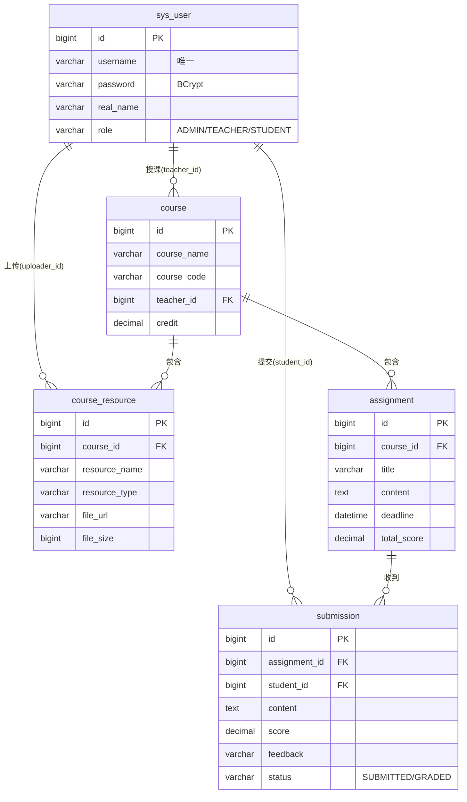

# 数据库设计说明

## 一、ER 图



## 二、表结构设计

共 10 张表（业务 5 表 + RBAC 权限 4 表 + 行为埋点 1 表），表名前缀与职责清晰：

| 表名 | 说明 | 关键字段 |
| --- | --- | --- |
| `sys_user` | 用户表（教师/学生/管理员） | username 唯一、role 粗粒度角色、password 存 BCrypt 密文 |
| `course` | 课程表 | teacher_id 关联授课教师 |
| `assignment` | 作业表 | course_id 关联课程、deadline 截止时间、total_score 满分 |
| `submission` | 作业提交表 | assignment_id + student_id 定位一条提交，status 标识批阅状态 |
| `course_resource` | 课程资源表 | course_id 关联课程、file_url 存文件访问路径 |
| `sys_role` / `sys_permission` | 角色表 / 权限表（RBAC） | role_code / perm_code |
| `sys_user_role` / `sys_role_permission` | 用户-角色 / 角色-权限关联表 | 多对多关联 |
| `student_behavior` | 学生行为埋点表（学习预警） | student_id + behavior_type + occur_time |

> 说明：`sys_user.role` 仅作粗粒度角色标识（用于 JWT 声明与前端菜单显隐），接口级细粒度授权由 RBAC 四表 + `@PreAuthorize` 完成；`student_behavior` 由 AOP 切面零侵入写入，支撑学习预警看板。

## 三、索引设计

- `sys_user.username`：唯一索引，保证账号唯一并加速登录查询。
- `course.teacher_id`：普通索引，加速按教师查询课程。
- `assignment.course_id`：普通索引，加速按课程查询作业。
- `submission.assignment_id` / `submission.student_id`：普通索引，加速批阅列表与学生查询。

> 设计取舍：外键约束交由应用层保证，数据库仅保留索引。这样在数据量大时可平滑过渡到分库分表，也避免了外键带来的写性能开销。

## 四、典型多表查询

### 1. 课程列表（课程 LEFT JOIN 用户）

```sql
SELECT c.*, u.real_name AS teacher_name
FROM course c
LEFT JOIN sys_user u ON c.teacher_id = u.id
WHERE c.course_name LIKE '%关键字%'
ORDER BY c.id DESC;
```

### 2. 作业列表（作业 LEFT JOIN 课程 + 聚合子查询）

```sql
SELECT a.*, c.course_name,
       (SELECT COUNT(*) FROM submission s WHERE s.assignment_id = a.id) AS submission_count,
       (SELECT COUNT(*) FROM submission s WHERE s.assignment_id = a.id AND s.status = 'GRADED') AS graded_count
FROM assignment a
LEFT JOIN course c ON a.course_id = c.id;
```

### 3. 提交记录（四表 JOIN）

```sql
SELECT s.*, a.title AS assignment_title, c.course_name, u.real_name AS student_name
FROM submission s
LEFT JOIN assignment a ON s.assignment_id = a.id
LEFT JOIN course c ON a.course_id = c.id
LEFT JOIN sys_user u ON s.student_id = u.id;
```

## 五、事务与隔离级别

批阅接口（`SubmissionService.grade`）标注 `@Transactional(rollbackFor = Exception.class)`：

- **原子性**：得分、反馈、状态、批阅时间四个字段要么同时成功、要么同时回滚，避免出现「分数已更新但状态仍是待批阅」的中间态。
- **隔离级别**：使用 MySQL InnoDB 默认的 `REPEATABLE READ`（Spring 默认 `READ_COMMITTED` 之上，由数据库决定）。可通过 `@Transactional(isolation = Isolation.READ_COMMITTED)` 显式指定。
- **脏读/不可重复读/幻读**：InnoDB 通过 MVCC + 间隙锁解决这些问题，可在答辩中展开。

## 六、建表脚本

见 `backend/src/main/resources/db/schema.sql`，全部使用 `CREATE TABLE IF NOT EXISTS`，幂等可重复执行。
